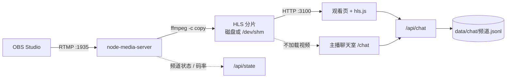

<div align="center">

# OBS Live

**OBS 推流 → RTMP 接入 → HLS 分发 → 网页观看 / 评论 / 主播聊天室**

[](https://nodejs.org)
[](https://ffmpeg.org)
[](LICENSE)
[](https://github.com/EndlessPixel/obs_broadcast_web/pulls)

</div>

---

> 一个为低配服务器设计的轻量直播服务。后端只有 Node.js + `node-media-server` + Express，视频由 `ffmpeg -c copy` 直接转封装成 HLS，**不重编码、不依赖数据库、不依赖 Redis、不使用前端框架**。单路直播时 Node 常驻约 70–120MB、转封装进程约 60MB / 3% CPU。
>
> 内置按频道隔离的评论区、在线人数统计，以及给主播用的纯聊天室页面。推流连接信息只输出到终端，网页与 API 均不返回。

如果这个项目对你有用，欢迎点个 Star。

## 目录

- [快速上手](#快速上手)
- [功能特性](#功能特性)
- [运行前置依赖](#运行前置依赖)
- [架构](#架构)
- [本地运行](#本地运行)
- [OBS 推流设置](#obs-推流设置)
- [配置项](#配置项)
- [带宽与容量](#带宽与容量)
- [评论区与主播聊天室](#评论区与主播聊天室)
- [HTTP API](#http-api)
- [项目结构](#项目结构)
- [生产部署](#生产部署)
- [安全说明](#安全说明)
- [常见问题](#常见问题)
- [本地开发](#本地开发)
- [致谢](#致谢)
- [许可证](#许可证)

## 快速上手

```bash
git clone https://github.com/EndlessPixel/obs_broadcast_web.git
cd obs_broadcast_web
npm ci
npm start
```

启动后终端会打印 OBS 服务器地址、串流密钥和观看页地址。在 OBS 里填入这两项并开始推流，浏览器打开 `http://localhost:3100` 即可看到画面。

## 功能特性

- **RTMP 接入**：`node-media-server` 监听 `1935`，支持多个频道并发（上限可配）
- **低消耗转封装**：`ffmpeg -c copy` 输出 HLS，不做视频重编码，CPU 占用极低
- **断流自愈**：播放列表 mtime 看门狗检测推流中断，自动重试、离线并清理过期分片
- **容量感知**：按实时推流码率估算可承载观众数，码率超限时页面给出告警
- **按频道隔离的评论区**：消息落磁盘 JSONL，服务重启即清空；用户名免注册、无密码
- **在线人数**：轮询兼心跳，30 秒无响应自动离线，按频道分别统计
- **主播身份认证**：口令由服务端校验，消息带 `role: host` 并显示「主播」徽章；观众无法靠改名冒充
- **主播聊天室**：`/chat` 独立页面，不加载视频、不请求 HLS，适合边推流边看评论
- **连接信息不外泄**：推流地址、端口、Token 只在启动日志 / `journalctl` 中显示
- **零依赖前端**：原生 HTML/CSS/JS + 本地 `hls.js`，无构建步骤

## 运行前置依赖

| 依赖 | 版本 / 说明 |
|---|---|
| Node.js | `>= 20`（`node-media-server` v4 要求） |
| npm | 随 Node 安装，用于 `npm ci` |
| ffmpeg | 必需，服务端转封装；旧版也可用（参数已收敛为通用 `delete_segments`） |
| OBS Studio | 推流端，输出需为 H.264 + AAC |
| 浏览器 | 支持 HLS 的 Chrome / Edge / Safari（通过本地 `hls.js` 播放） |

## 架构



HLS 播放列表不缓存（`no-cache`，内容未变时返回 304），分片短缓存。每位观众消耗一份推流码率的**服务器出口带宽**，这是低带宽环境下唯一的硬瓶颈。

## 本地运行

```bash
npm ci
npm start
```

项目根目录可放 `.env`（参考 `.env.example`），`server/config.js` 内置极简解析，**不需要 `dotenv` 依赖**；已存在的环境变量优先于 `.env`。

```bash
cp .env.example .env
# 按需修改后
npm start
```

启动日志示例：

```text
==== OBS 连接信息（仅终端显示，网页 / API 不返回）====
  服务器:   rtmp://192.168.x.x:1935/live
  同机推流: rtmp://127.0.0.1:1935/live
  串流密钥: studio?token=xxxxxxxx
  观看页:   http://192.168.x.x:3100
  建议码率: 1600 Kbps / 上行 8Mbps / 最多 3 路
```

## OBS 推流设置

在「设置 → 推流」中选择「自定义」：

| 字段 | 值 |
|---|---|
| 服务器 | `rtmp://<服务器IP>:1935/live` |
| 串流密钥 | `studio?token=<STREAM_TOKEN>`；未启用 Token 时只填 `studio` |

`studio` 是频道名，可替换为任意 `A-Z a-z 0-9 _ -`（最长 48 位），网页频道列表会自动出现新频道。Token 部分保持不变。

输出建议：

| 项目 | 建议值 |
|---|---|
| 视频编码器 | H.264（x264 / NVENC 等），**不要用 HEVC / AV1** |
| 音频编码器 | AAC |
| 关键帧间隔 | 2 秒 |
| 码率 | 见下方带宽表，8Mbps 上行建议 1500–1800 Kbps |
| 分辨率 / 帧率 | 720p30 或 640×360@30 |

> 连接信息只在终端输出。systemd 部署时用 `journalctl -u obs-live -n 30` 查看。

## 配置项

全部通过环境变量或 `.env` 设置，无需改代码。

| 变量 | 默认值 | 说明 |
|---|---|---|
| `HTTP_PORT` | `3100` | Web 服务端口，建议只对本机 / 反向代理开放 |
| `RTMP_PORT` | `1935` | OBS 推流端口 |
| `STREAM_TOKEN` | 空 | 为空表示不校验；设置后串流密钥需写成 `频道名?token=值` |
| `HOST_TOKEN` | 空 | 主播聊天身份验证口令；留空则复用 `STREAM_TOKEN`，两者都为空时不启用主播标识 |
| `UPLINK_MBPS` | `8` | 服务器实际上行带宽，用于建议码率与观看人数估算；`<=10` 自动启用省流轮询 |
| `MAX_STREAMS` | `3` | 最大并发频道数，每个频道一个轻量 ffmpeg 进程 |
| `HLS_TIME` | `2` | 分片时长（秒），越小延迟越低 |
| `HLS_LIST_SIZE` | `5` | 播放列表保留的分片数 |
| `HLS_DIR` | `public/hls` | 分片目录；小服务器建议 `/dev/shm/obs-live-hls` 写内存盘 |
| `FFMPEG` | `ffmpeg` | ffmpeg 可执行文件路径 |

`.env` 已在 `.gitignore` 中，**请不要把真实 Token 提交到仓库**。

## 带宽与容量

每位 HLS 观众消耗一份推流码率。页面按 `上行 × 85% ÷ 实时码率` 估算人数，并在码率超过建议值时显示告警。

以 **8Mbps 上行** 为例（预留 15%）：

| 推流码率 | 可承载观众 |
|---|---|
| 1000 Kbps | 6 人 |
| 1200 Kbps | 5 人 |
| 1600 Kbps | 4 人 |
| 2000 Kbps | 3 人 |
| 2500 Kbps | 2 人 |
| 3000 Kbps 以上 | 2 人或更少 |

降低 OBS 码率是唯一有效的优化手段。轮询频率、播放列表 304 等只影响几百字节的小请求，相对视频流可以忽略。若需要支持更多观众，应使用 CDN 或外部反代分流 —— **在同一台服务器上加 nginx 缓存不会减少出口带宽**。

## 评论区与主播聊天室

| 页面 | 地址 | 说明 |
|---|---|---|
| 观看页 | `/` | 播放器 + 频道列表 + 资源状态 + 评论区 |
| 主播聊天室 | `/chat`（自动跳转到 `/chat/`） | 只看评论、在线人数、频道切换；不加载 hls.js、不创建 `<video>`、不请求 HLS |

评论区行为：

- 消息按频道写入 `data/chat/<频道>.jsonl`（磁盘文件），**服务每次启动自动清空**
- 首次进入输入用户名即可发言，存浏览器 `localStorage`，无密码、无注册；头部可改名
- 轮询兼心跳，30 秒无响应自动离线；发送限频 800ms，单条消息最多 200 字
- 服务端重启后返回新的 `epoch`，已打开的页面会自动重置消息游标
- 所有用户内容用 `textContent` 渲染，避免 XSS

主播身份：

- 主播在 `/chat` 页面点「主播验证」，输入服务器终端里的主播口令（默认与 `STREAM_TOKEN` 相同）
- 服务端校验通过后把该浏览器 `uid` 标记为主播（12 小时有效期，服务重启即失效），之后消息带 `role: host` 并显示红色「主播」徽章
- 身份由服务端下发，**观众即使把用户名改成「主播」也不会有徽章**；客户端传来的 `role` / `host` 字段一律忽略
- 口令只保存在本机浏览器、通过 POST 提交，不进 URL、不进服务器日志；连续 5 次验证失败会限流 1 分钟

## HTTP API

| 方法 | 路径 | 说明 |
|---|---|---|
| `GET` | `/api/state` | 在线频道、实时码率、`capacity`（上行 / 建议码率 / 观看上限 / 是否超限） |
| `GET` | `/api/health` | 健康检查与在线频道数 |
| `GET` | `/api/chat/:channel?since=&uid=&name=` | 拉取新消息、更新心跳，返回 `epoch` / `messages` / `online` / `isHost` |
| `POST` | `/api/chat/:channel` | 发送消息，body 为 `{ uid, name, text }`；身份由服务端判定 |
| `POST` | `/api/chat/:channel/leave` | 离开频道，body 为 `{ uid }` |
| `POST` | `/api/chat/host/verify` | 主播身份验证，body 为 `{ uid, token }` |
| `GET` | `/hls/:channel/index.m3u8` | HLS 播放列表（静态文件） |

API **不返回** RTMP 地址、端口或推流 Token。

## 项目结构

```text
.
├── server/
│   ├── index.js            # Express、RTMP 接入、API、启动日志
│   ├── config.js           # 环境变量与极简 .env 解析
│   ├── stream-manager.js   # ffmpeg 转封装、断流看门狗、分片清理
│   └── chat-store.js       # 评论落盘、频道隔离、在线心跳
├── public/
│   ├── index.html          # 观看页
│   ├── app.js              # 播放器与频道切换
│   ├── chat.js             # 观看页评论区
│   ├── styles.css
│   └── chat/
│       ├── index.html      # 主播聊天室 /chat
│       └── chat-room.js
├── deploy/
│   ├── obs-live.service    # systemd 单元
│   ├── nginx-obs-live.conf # 反向代理示例
│   └── post-receive        # git 自动部署钩子
├── .env.example
├── package.json
└── LICENSE
```

## 生产部署

```bash
# 1. 安装依赖（Node >= 20、ffmpeg）
sudo apt install -y ffmpeg

# 2. 部署代码
sudo mkdir -p /opt/obs-live
cd /opt/obs-live
npm ci --omit=dev
cp .env.example .env    # 务必设置 STREAM_TOKEN

# 3. 创建低权限用户
sudo useradd -r -s /usr/sbin/nologin obslive
sudo chown -R obslive:obslive /opt/obs-live

# 4. 安装服务（按实际路径修改 ExecStart 与 WorkingDirectory）
sudo cp deploy/obs-live.service /etc/systemd/system/
sudo systemctl daemon-reload
sudo systemctl enable --now obs-live

# 5. 查看连接信息
journalctl -u obs-live -n 30
```

`deploy/post-receive` 可放到服务器的 bare 仓库 `hooks/` 下，实现 `git push` 自动部署：

- 每次推送自动检出 `main` 到工作目录
- **只有 `server/` 下的运行时代码变更才重启服务**；纯前端 / 文档变更由 `express.static` 实时读盘，不重启、不断流、不清空评论
- 依赖变更仍需手动执行 `npm ci --omit=dev`

防火墙建议：只放行 `80/443`（或 Web 端口）与 `1935`。若使用域名 + HTTPS，需在反向代理中同时代理页面和 `/hls`，保证**同源同协议**，否则浏览器会拦截混合内容。参考配置见 `deploy/nginx-obs-live.conf`。

## 安全说明

- 公网部署务必设置 `STREAM_TOKEN`，否则任何人都能向你的频道推流
- 建议把 `1935` 限制为只允许推流端 IP，Web 端口只对本机 / 反向代理开放
- 启动日志包含完整串流密钥，请限制终端输出与 `journald` 的读取权限
- 不要把 `.env`、真实 Token 或服务器凭据提交到仓库
- 主播口令通过 `POST /api/chat/host/verify` 提交，不出现在 URL 和日志中；主播浏览器本地会保存一份，共用设备请注意退出
- 评论内容不经过转义直接落盘，但前端使用 `textContent` 渲染，不会执行 HTML

## 常见问题

### 推流后网页没有画面

依次检查：OBS 视频编码是否为 H.264、音频是否 AAC、串流密钥是否包含正确的 `?token=`、防火墙是否放行 `1935`、终端日志是否出现「频道上线」。HEVC / AV1 无法直接封装成 MPEG-TS 分片。

### 评论区输入框点不动、一直显示「连接中」

通常是浏览器缓存了旧版 JS，强制刷新 `Ctrl+Shift+R`（macOS `Cmd+Shift+R`）。前端脚本均以 IIFE 隔离，避免多个 `defer` 脚本重复声明全局变量导致整个脚本不执行。

### 多人同时观看就卡

这是出口带宽耗尽，不是 CPU 或内存问题。降低 OBS 码率，或限制观看人数；需要更多并发请使用 CDN。

### 观众冒充主播名字

身份不看名字文本，只看服务端下发的 `role`。观众输入「主播」两个字也不会有徽章；只有持有主播口令并通过 `POST /api/chat/host/verify` 的浏览器，发出的消息才会被服务端标记为 `host`。若未设置 `STREAM_TOKEN` / `HOST_TOKEN`，主播标识功能不可用。

### 重启后评论没了

设计如此：评论写入磁盘文件，但服务启动时 `ChatStore.reset()` 会清空，不跨重启保留；主播身份验证状态也会失效，重新打开 `/chat` 会用口令自动重新验证。

### HTTPS 页面无法播放

页面与 `/hls` 必须同源同协议。给页面上 HTTPS 但 HLS 仍是 HTTP 会被浏览器拦截，需要在反向代理里一起代理。

### systemd 报 `203/EXEC`

如果 Node 装在 `/root/.nvm` 等低权限用户无法穿越的目录，需把 `node` 二进制复制到 `/usr/local/bin/` 等全局可执行路径，再修改 `ExecStart`。

### 端口被占用

用 `HTTP_PORT` / `RTMP_PORT` 环境变量改端口，无需改代码。

## 本地开发

```bash
npm run dev     # node --watch，修改后自动重启
npm test        # 所有 JS 文件的语法检查
```

本地服务默认监听 `3100` 与 `1935`。若不需要本地实例，直接关闭即可，不影响已部署的生产服务。

## 致谢

- [node-media-server](https://github.com/illuspas/Node-Media-Server) — RTMP 接入
- [hls.js](https://github.com/video-dev/hls.js) — 浏览器端 HLS 播放
- [FFmpeg](https://ffmpeg.org) — 转封装
- [Express](https://expressjs.com) — Web 服务与静态文件

## 许可证

[Apache License 2.0](LICENSE)

Copyright (c) 2026 EndlessPixel
